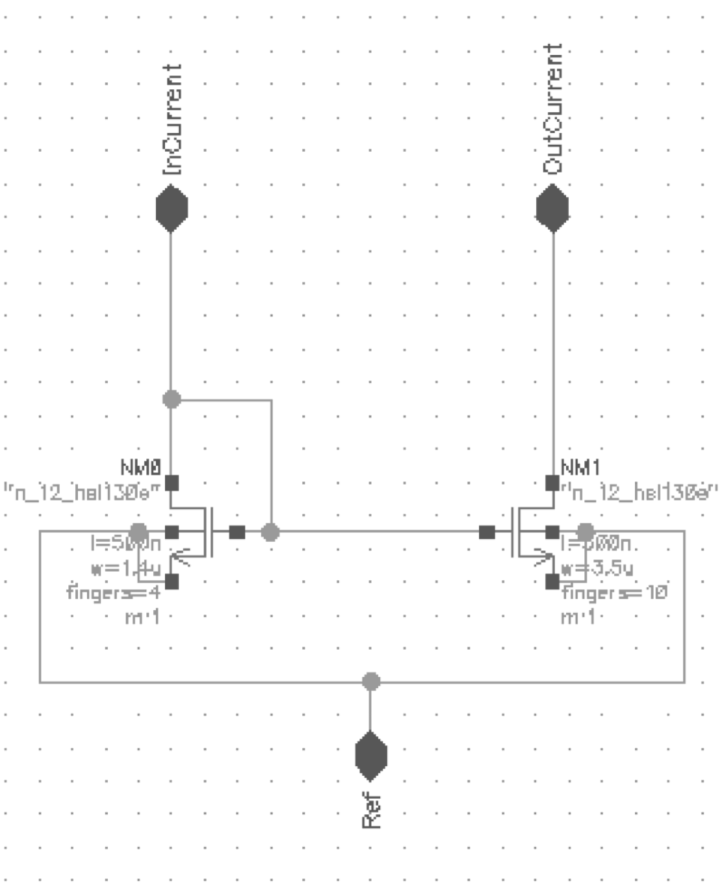
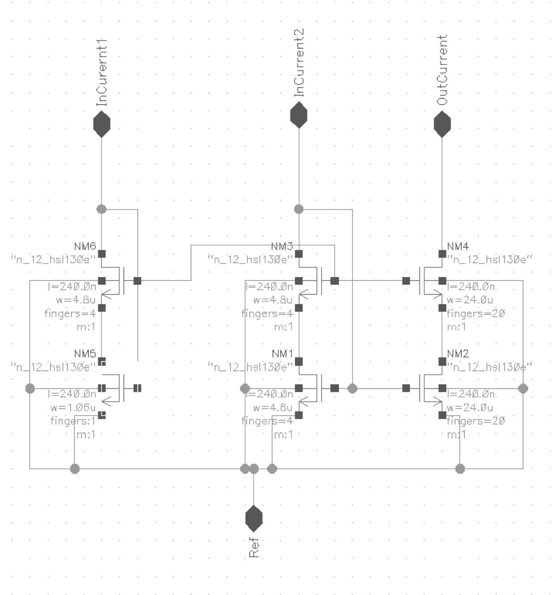
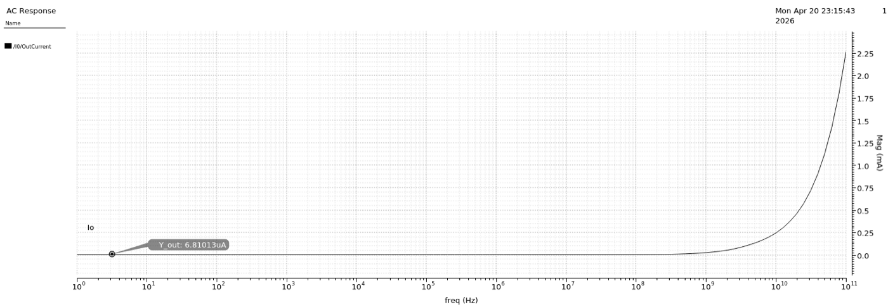

# Lab 01 — CMOS Current Mirrors

Full write-up: Chapter 1 of the [report](../report/AICD_lab_report.pdf).

## Simple n-MOS mirror (N = 2.5, IREF = 100 µA)

- **DC sweep:** IOUT equals N·IIN only at VOUT = 510.8 mV, where VDS1 = VDS2. Elsewhere, channel-length modulation sets the error.
- **Output impedance:** Ro ≈ 25 kΩ from the AC admittance. The output pole is predicted at 1.32 GHz and simulated at 2.88 GHz; the gap comes from parasitics outside the hand model.
- **Geometry:** sweeps of gate length (100–500 nm) and finger count (4 vs 10) show the layout-dependent shifts in Vth and mirror accuracy.

## Process spread and mismatch

| Corner | VIN [mV] | ΔIOUT [µA] |
|---|---|---|
| TT, 27 °C | 686.0 | −3.10 |
| SS, −20 °C | 751.4 | −5.52 |
| FF, 85 °C | 630.8 | −1.16 |

The Monte Carlo run (N = 100) gives μ(ΔIOUT) = −3.09 µA, the systematic error, and σ = 5.18 µA, the random mismatch. This agrees with the Pelgrom-model hand estimate of 6.32 µA.

## Wide-swing cascode mirror

- Bias device M5 was sized by parametric sweep (W5 = 1.06 µm) so that all four VDS values land near 250 mV.
- Scaling every L by √3 raises Rout to **146.8 kΩ** (theory ≈ 110 kΩ), at the cost of 2.25× area.

