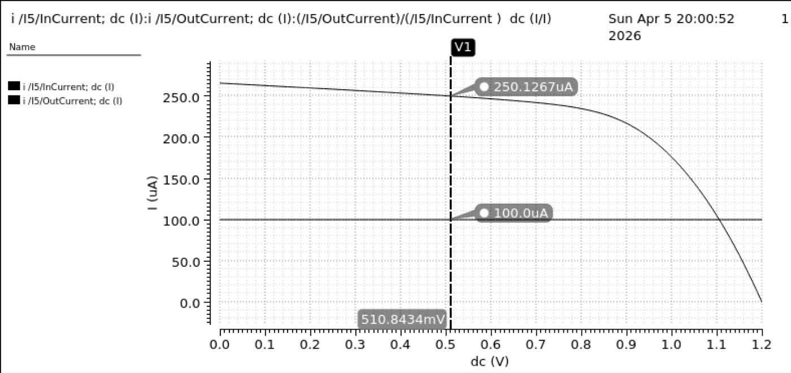
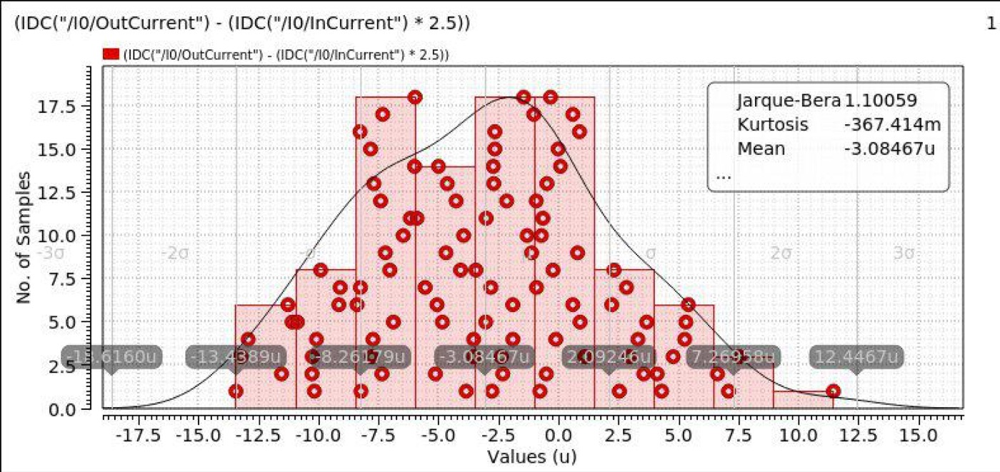

# Lab 01: CMOS current mirrors

Chapter 1 of the [report](../report/AICD_lab_report.pdf) has the full write-up.

## Simple n-MOS mirror, N = 2.5 and IREF = 100 µA

A DC sweep of the output shows that IOUT equals N·IIN only at VOUT = 510.8 mV, where VDS1 = VDS2. At every other voltage, channel-length modulation sets the error.

The AC output admittance gives Ro ≈ 25 kΩ. The hand model predicts the output pole at 1.32 GHz, and simulation puts it at 2.88 GHz. The difference comes from parasitic capacitances that the hand model leaves out.

Sweeps of the gate length from 100 to 500 nm and of the finger count, 4 against 10, show how layout shifts Vth and the mirror accuracy.

## Process spread and mismatch

| Corner | VIN [mV] | ΔIOUT [µA] |
|---|---|---|
| TT, 27 °C | 686.0 | −3.10 |
| SS, −20 °C | 751.4 | −5.52 |
| FF, 85 °C | 630.8 | −1.16 |

A Monte Carlo run with N = 100 gives a mean ΔIOUT of −3.09 µA, which is the systematic error, and σ = 5.18 µA, which is the random mismatch. The Pelgrom-model hand estimate is 6.32 µA.

## Wide-swing cascode mirror

We sized the bias device M5 with a parametric sweep, W5 = 1.06 µm, so that all four VDS values sit near 250 mV. Scaling every L by √3 raises Rout to 146.8 kΩ against a theoretical 110 kΩ, at the cost of 2.25 times the area.

