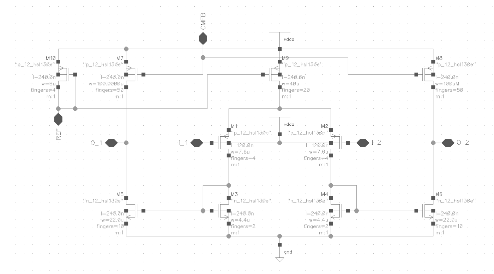
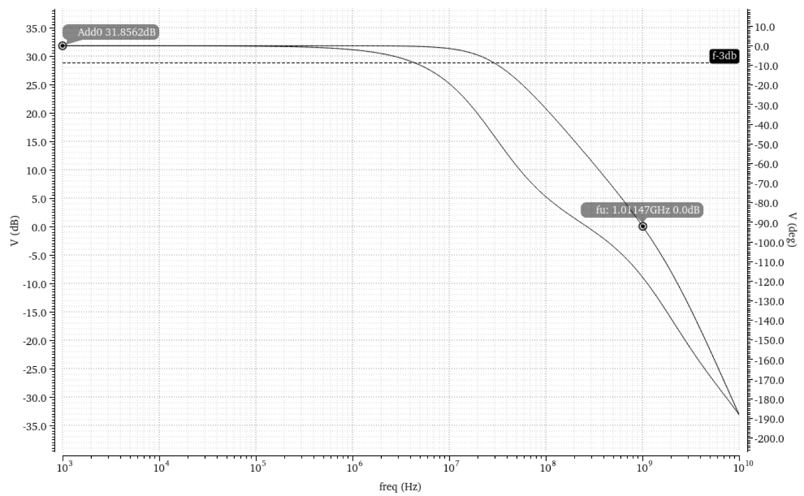
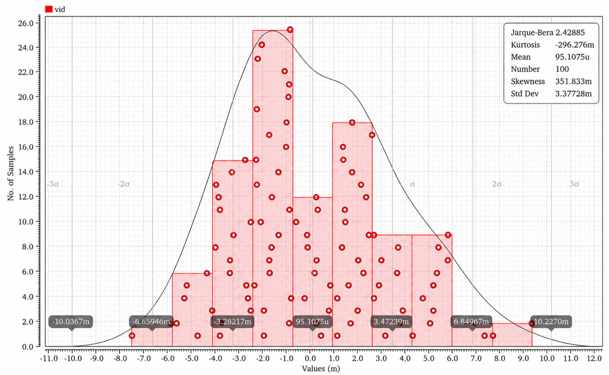

# Lab 02 — Fully Differential Current-Mirror OTA

Full write-up: Chapter 2 of the [report](../report/AICD_lab_report.pdf).

**Topology:** p-MOS input differential pair, current-mirror loads with gain to the output branches, and common-mode feedback (CMFB).

## Process

1. **Initial design:** DC operating point, gm and ro per device, and current steering in the differential pair. Add0 = 22.6 dB and fu = 690 MHz, below specification.
2. **Common-mode analysis:** very low common-mode gain, so CMRR is high.
3. **Monte Carlo offset (N = 100):** VOS = 7.28 mV for the initial design.
4. **Redesign:** re-biased the input pair (ID ≈ 188 µA), then widened it from 20 µm to 33 µm to raise gm1 and reach the GBW target.

## Final design vs specification

| Parameter | Specification | Simulated |
|---|---|---|
| Add0 | > 30 dB | **31.86 dB** |
| GBW | ≥ 1 GHz | **1.01 GHz** |
| VOS (σ, Monte Carlo) | < 4 mV | **3.38 mV** |

