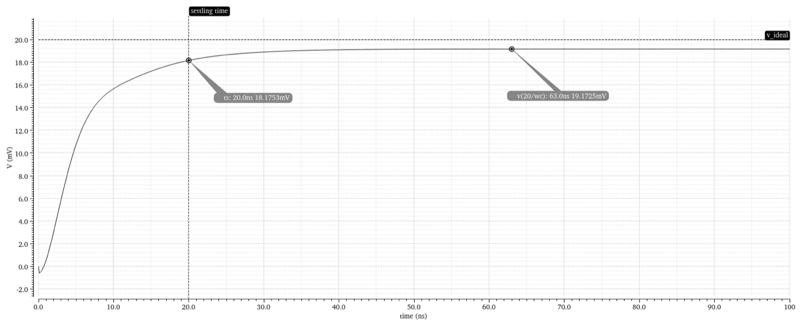

# Lab 03: two-stage OTA in a capacitive-feedback amplifier

Chapter 3 of the [report](../report/AICD_lab_report.pdf) has the full write-up.

## Starting point

The given OTA sits in a capacitive-feedback loop with β = 0.33 and an ideal gain Cs/Cf = 2. It had T0 = 37.8 dB, fc = 251 MHz and a phase margin of only 23°, and its closed-loop response showed strong peaking and ringing.

## Redesign from the specification

- A static error of at most 0.2 % needs T0 ≥ 1/ε0, so Add0 must be about 1500 or more.
- A dynamic error of at most 0.2 % at 20 ns needs ωc ≥ −ln(0.002)/20 ns, so fc ≈ 50 MHz.
- Each branch is biased at ID = 225 µA with VOV = 0.15 V, so gm = 3 mS. The required ro sets the lengths, and the square-law model sets the widths.
- Compensation uses a Miller capacitor CC ≈ 1.6 pF with a nulling resistor RZ, both tuned in simulation.

## Final results

| Metric | Value |
|---|---|
| Loop gain T0 | 58.2 dB |
| Crossover fc | 50.5 MHz |
| Phase margin | 61.4°, specification 60 to 70° |
| Input offset VOS, Monte Carlo with N = 100 | 0.90 mV, specification ≤ 2 mV |
| Power | 1.20 mW, ITOT ≈ 1 mA at 1.2 V |
| Closed-loop gain | 1.92 against an ideal 2 |

Two specifications were not met. The static error is 4.1 % and the dynamic error is 5.2 %, against targets of 0.2 %. The report traces both to a non-dominant pole near crossover, which breaks the single-pole settling assumption, and discusses the trade-off.

