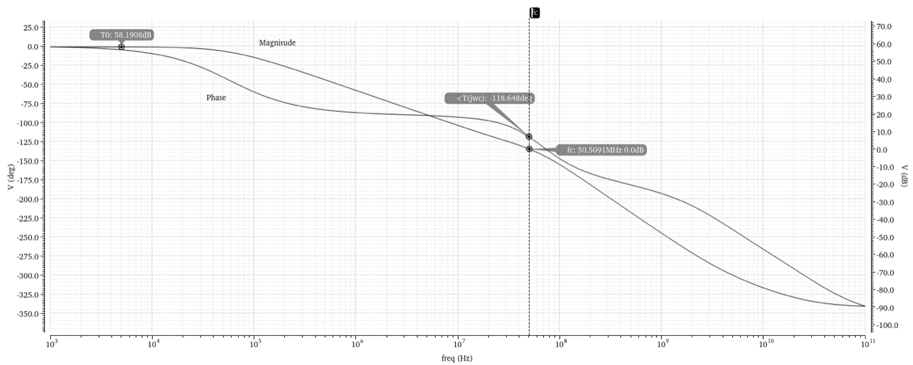
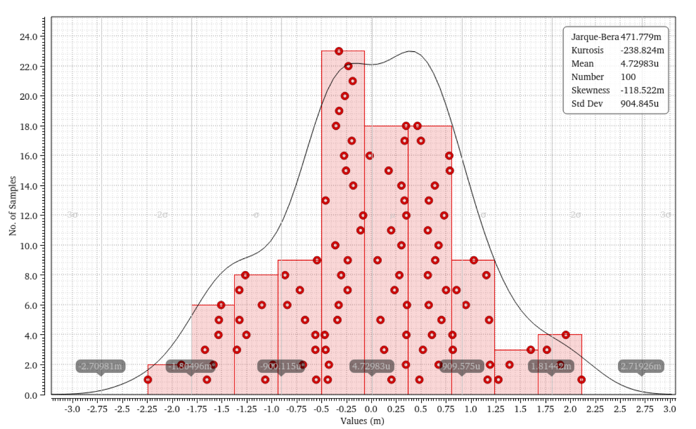

# Lab 03 — Two-Stage OTA and Capacitive-Feedback Amplifier

Full write-up: Chapter 3 of the [report](../report/AICD_lab_report.pdf).

## Starting point

The given OTA in a capacitive-feedback loop (β = 0.33, ideal gain Cs/Cf = 2) had T0 = 37.8 dB, fc = 251 MHz and only **23° phase margin**. The closed-loop response showed strong peaking and ringing.

## Redesign from the specifications

- **Static error ≤ 0.2 %** → T0 ≥ 1/ε0 → Add0 ≳ 1500.
- **Dynamic error ≤ 0.2 % at 20 ns** → ωc ≥ −ln(0.002)/20 ns → fc ≈ 50 MHz.
- **Biasing:** ID = 225 µA per branch, VOV = 0.15 V, gm = 3 mS. Lengths set from the required ro, and widths from the square-law model.
- **Compensation:** Miller capacitance CC ≈ 1.6 pF with a nulling resistor RZ, then tuned in simulation.

## Final results

| Metric | Value |
|---|---|
| Loop gain T0 | 58.2 dB |
| Crossover fc | 50.5 MHz |
| Phase margin | **61.4°** (spec 60–70°) |
| Input offset VOS (Monte Carlo, N = 100) | **0.90 mV** (spec ≤ 2 mV) |
| Power | 1.20 mW (ITOT ≈ 1 mA at 1.2 V) |
| Closed-loop gain | 1.92 (ideal 2) |

**Specifications not met:** the static (4.1 %) and dynamic (5.2 %) errors missed the very tight 0.2 % targets. The report traces this to a non-dominant pole near crossover, which breaks the single-pole settling assumption, and discusses the trade-off.

