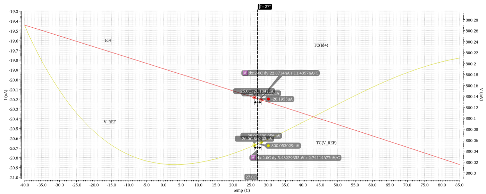
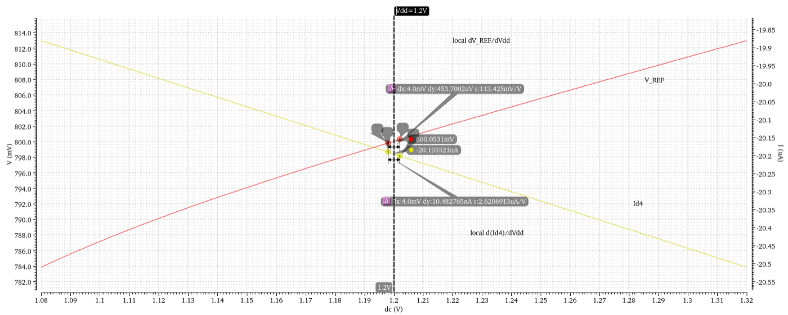

# Lab 04: low-voltage bandgap voltage reference

Chapter 4 of the [report](../report/AICD_lab_report.pdf) has the full write-up.

The target is a sub-1 V reference, VREF = 0.8 V, from a 1.2 V supply, with a temperature coefficient close to zero.

## Design

We started the hand design from I1 = 10 µA and a diode area ratio N = 4. R1 = UT ln N / I1 sets the PTAT current, R2 ≈ 54 kΩ cancels the CTAT slope, and R3 scales the output to 0.8 V. The PMOS mirror uses L = 1.2 µm to limit channel-length modulation, and W ≈ 8.6 µm follows from |VOV| = 0.25 V.

A first temperature sweep from −40 to 85 °C confirmed the PTAT and CTAT behaviour and gave a TC of 32 ppm/°C. We then tuned the resistors in order. R1 sets ID1 to 10.00 µA, R2 minimizes the TC through a coarse and a fine sweep, and R3 sets the absolute VREF.

## Final results

| Metric | Value |
|---|---|
| VREF at 27 °C | 800.05 mV |
| Local TC at 27 °C | ≈ 3.4 ppm/°C |
| TC over −40 to 85 °C, box method | ≈ 2.5 ppm/°C, with a total ΔVREF of about 0.25 mV. The target was 2 ppm/°C. |
| Line sensitivity dVREF/dVDD | 113 mV/V for VDD ± 10 % |

The remaining curvature of VREF(T) comes from the temperature dependence of IS, which the first-order hand model leaves out. The minimum of the curve sits near 0 °C, below the centre of the range. A slightly smaller R2 would move it to the centre and lower the full-range TC.

