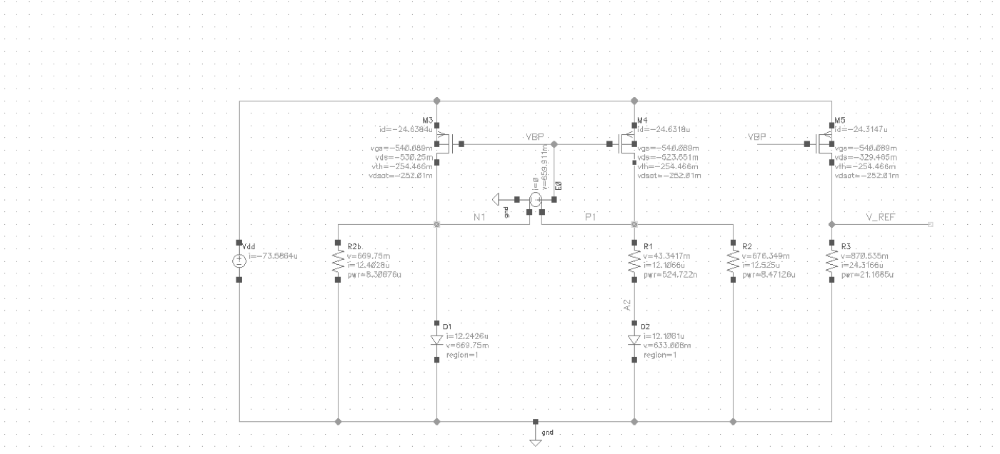
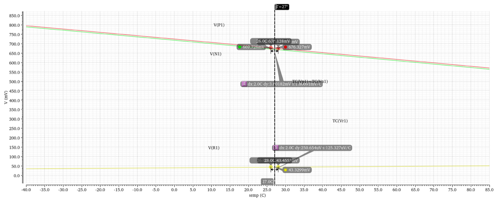

# Lab 04 — Low-Voltage Bandgap Voltage Reference

Full write-up: Chapter 4 of the [report](../report/AICD_lab_report.pdf).

**Target:** a sub-1 V reference, VREF = 0.8 V, from a 1.2 V supply, with near-zero temperature coefficient.

## Design

- **Hand design:** I1 = 10 µA and diode area ratio N = 4. Then R1 = UT ln N / I1 sets the PTAT current, R2 ≈ 54 kΩ cancels the CTAT slope, and R3 scales the output to 0.8 V.
- **PMOS mirror:** L = 1.2 µm to suppress channel-length modulation, and W ≈ 8.6 µm from |VOV| = 0.25 V.
- **Characterisation:** PTAT and CTAT node voltages and branch currents across −40…85 °C. The initial TC is 32 ppm/°C.
- **Sequential resistor tuning:** R1 sets ID1 = 10.00 µA, R2 zeroes the TC with coarse and fine sweeps, and R3 sets the absolute VREF.

## Final results

| Metric | Value |
|---|---|
| VREF at 27 °C | **800.05 mV** |
| Local TC at 27 °C | ≈ 3.4 ppm/°C |
| Box-method TC, −40…85 °C | **≈ 2.5 ppm/°C** (total ΔVREF ≈ 0.25 mV; target 2 ppm/°C) |
| Line sensitivity dVREF/dVDD | 113 mV/V (VDD ± 10 %) |

The remaining curvature in VREF(T) is the expected second-order effect of the temperature dependence of IS, which the first-order hand model leaves out. The curve's minimum sits near 0 °C instead of the centre of the range. A slightly smaller R2 would centre it and lower the full-range TC further.

